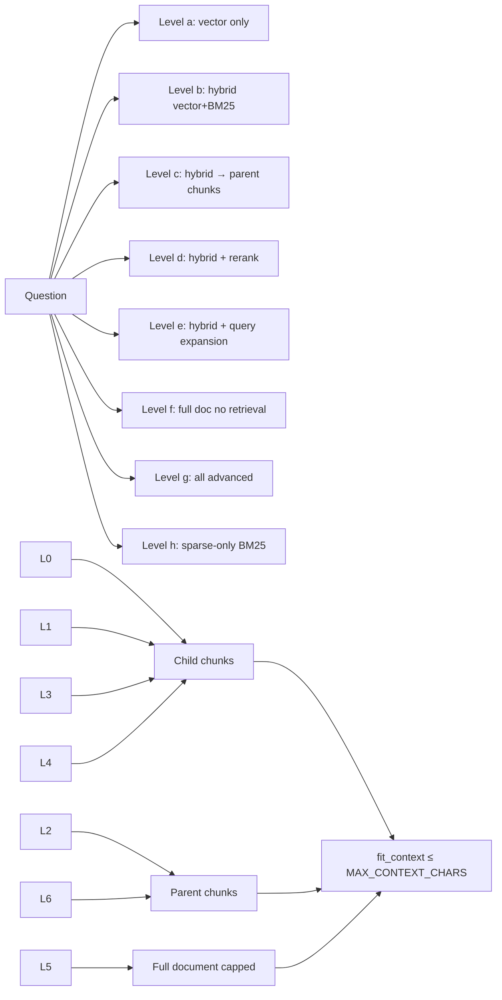

# RAG Exploration Log

**Started:** 2026-07-16  
**Purpose:** Record why personal RAG attempts underperform compared to commercial/web chatbot RAG, and document the controlled experiment used to isolate which RAG features actually close the gap.

---

## Query

> Why do my own attempts to do RAG seem miserable, but when ChatGPT, Gemini in web chatbot, or agent harnesses like pi.dev use it when I feed a document and ask a query, the results are really good?

---

## Findings / Summary

**Short answer:** Personal "naive RAG" pipelines usually underperform because commercial experiences combine **advanced RAG**, **very large context windows**, and **stronger underlying models** — often all at once.

### 1. What most people build first: naive RAG

Typical pipeline:
1. Split text into fixed-size chunks (e.g., 512 chars).
2. Embed each chunk with a generic embedding model.
3. Store in a vector database.
4. Query: embed question → cosine similarity search → top-k chunks → stuff into prompt.

Common failure modes:
- **Bad chunking:** sentences/tables/code split across chunk boundaries; chunks lack standalone context.
- **Generic embeddings:** not domain-tuned; semantic mismatch between query and stored chunks.
- **Pure vector search:** no BM25/keyword fallback; exact terms (product names, error codes) get buried.
- **No reranking:** top-5 by cosine similarity are not necessarily the 5 most useful chunks.
- **No query transformation:** user question used as-is (no expansion, synonyms, or hypothetical document embedding).
- **Stuffing:** raw chunks dumped into the prompt with no weighting, dedup, or token-limit awareness.

Result: model receives poor context and either hallucinates, misses the answer, or refuses.

### 2. What good systems actually do (advanced RAG)

- **Smart chunking:** recursive/semantic/structure-aware splitting; keep headings with sections, don't split tables, use parent-child chunks.
- **Hybrid search:** vector search + BM25/keyword, fused (e.g., RRF).
- **Reranking:** cross-encoder (BGE-reranker, Cohere rerank) re-scores top candidates and drops noise.
- **Query expansion/rewriting:** HyDE, multi-query, or LLM rewrites question into search-friendly variants before retrieval.
- **Metadata filtering:** date, document type, permissions applied before vector search.
- **Context compression:** only relevant sentences kept, or chunks summarized before generation.
- **Evaluation loop:** RAGAS or similar metrics; system tuned based on observed failures.

### 3. The hidden factor: it may not be RAG at all

Web chatbots (ChatGPT, Gemini, Claude) often use **very large context windows** (128k–1M+ tokens), not retrieval. The whole document is parsed (OCR, tables, images) and stuffed into the prompt. For documents under ~100 pages, long-context generation usually beats homemade RAG because nothing is lost to a bad retrieval step.

### 4. The model matters enormously

A 7B/13B local model over retrieved chunks is not comparable to GPT-4o, Gemini 2.5, or Claude Sonnet 4. Frontier models are better at ignoring irrelevant context, combining facts across chunks, and saying "I don't know" instead of hallucinating.

### 5. What to try next (in order of effort)

1. Check if retrieval is even needed — if the document fits in the model's context window, paste the whole document in.
2. Improve chunking (paragraph/section/sentence splits with overlap, not fixed character count).
3. Add hybrid search (vector + BM25).
4. Add a reranker (cross-encoder) over top vector results.
5. Rewrite the query (multi-query / HyDE) before retrieval.
6. Use a stronger embedding model (BGE, E5, Cohere).

### Diagnostic questions

- Am I splitting documents in ways that break meaning across chunk boundaries?
- Am I retrieving only by vector similarity, with no keyword fallback?
- Am I feeding top chunks raw, or reranking/compressing them first?
- Am I comparing my pipeline to a system that pastes the whole document into a 200k-token context window?

---

## Experimental Design

To isolate which RAG features actually matter, we run a controlled experiment on a **single document** where everything is held constant except the feature under test. The implementation lives in `rag_experiment.py` (same directory).

### Feature levels

| Level | Configuration |
|-------|---------------|
| a | Naive RAG: vector search on child chunks, return child chunks |
| b | + Hybrid: vector + BM25 keyword search (RRF fused), return child chunks |
| c | + Parent-child: vector search on child chunks, return **parent chunks** as context |
| d | + Cross-encoder reranking over top candidates, return child chunks |
| e | + Query expansion (multi-query via LLM), return child chunks |
| f | Full-context baseline: no retrieval, whole document in prompt (constrained to same window) |
| g | All advanced: hybrid + parent-child + rerank + query expansion |
| h | Sparse-only RAG: BM25 keyword search only, return child chunks |

## Key Terms & Glossary

The following terms are used throughout the experiment script and logs. They are defined here so the levels table and constants table are readable without outside knowledge.

### Bi-encoder (Embedder)
A model that encodes the **query** and each **document chunk independently** into separate vectors. At search time, the query vector is compared against all pre-computed chunk vectors using cosine similarity.  
**Pros:** Fast — chunks are embedded once at index time; search is just vector math.  
**Cons:** The query and chunk never "see" each other during encoding, so subtle relationships (negation, specific entity binding, exact phrases) can be missed.  
**In this script:** `Embedder` + `VectorStore`.

### Cross-encoder (Reranker)
A model that takes the **query and a candidate chunk together as a single input pair** and outputs a single relevance score. Because both texts are processed jointly (self-attention across both), it is more accurate than a bi-encoder but much slower — it cannot pre-compute scores, so it is applied only to a small candidate pool.  
**In this script:** `Reranker`, applied at levels d and g over the top 50 hybrid candidates.

### Dense retrieval (vector search)
Search by converting text into high-dimensional vectors and finding chunks whose vectors are closest to the query vector. Good for semantic meaning (e.g., "how do I restart the cluster?" matches "cluster reboot procedure" despite different words). Weak at exact terms (error codes, product names, acronyms).

### Sparse retrieval (BM25)
Search by matching exact words/terms using statistical frequency (Okapi BM25). Good for exact terms ("ERR-003", "worker-gpu", "novactl"). Weak at semantic paraphrase.

### Hybrid search (vector + BM25, fused with RRF)
Runs dense and sparse search in parallel, producing two ranked lists, then fuses them into one. This captures both semantic matches and exact-term matches. In this script, fusion uses Reciprocal Rank Fusion.

### RRF (Reciprocal Rank Fusion)
A formula for fusing ranked lists without needing to compare raw scores (which are on different scales for vector similarity vs. BM25). For each document, score = sum of `1 / (k + rank)` across all lists where it appears, where `k` is a smoothing constant (60 in this script). Documents that rank highly in multiple lists rise to the top.

### Parent-child retrieval
The document is chunked twice: small **children** (512 chars) for retrieval, larger **parents** (1,536 chars) for context. At search time, the best children are found, then the **parent chunks containing those children** are returned to the LLM. A child may contain a keyword match but lack surrounding context; the parent gives the model the full section around the match.  
**In this script:** Levels c and g. Child-to-parent mapping is built via character-offset containment (`build_child_to_parent_map`).

### Query expansion / multi-query
The LLM rewrites the user's original question into 2–3 alternative phrasings. Each variant is searched separately, and results are fused. Helps when the user's wording differs from the document's wording.  
**In this script:** Level e.

### Full-context baseline (level f)
No retrieval at all. The entire document (capped at `MAX_CONTEXT_CHARS`) is stuffed into the prompt as context. This answers: "Would the model do just as well reading everything without any retrieval?"

### Context window cap (`MAX_CONTEXT_CHARS`)
A hard limit on how much context text is passed to the LLM. In this script it is **derived** from retrieval parameters, with a 10% buffer for headroom:

```
CHILD_CONTEXT_CHARS   = TOP_K * (CHUNK_SIZE + overhead)
PARENT_CONTEXT_CHARS  = max(3, TOP_K // 2) * (PARENT_CHUNK_SIZE + overhead)
RAW_CAP               = max(CHILD_CONTEXT_CHARS, PARENT_CONTEXT_CHARS)
MAX_CONTEXT_CHARS     = int(RAW_CAP * 1.10)   # 10% buffer
```

With `TOP_K=5`, `CHUNK_SIZE=512`, `PARENT_CHUNK_SIZE=1536`, `overhead=120`:
- Child budget: 5 × (512 + 120) = 3,160
- Parent budget: 3 × (1536 + 120) = 4,968
- Raw cap: 4,968
- With 10% buffer: **5,464 characters**

This is enough for 5 child chunks or up to 3 whole parent chunks plus formatting overhead. The cap is identical across all levels so context capacity never confounds the comparison.

At parent-child levels (c and g), whole parents are selected greedily by score until the next parent would exceed the cap. Parents are never truncated mid-text — if only one to three parents fit, only those are returned.

### Thinking level / reasoning effort (`THINKING_LEVEL`)
A fixed parameter sent to the LLM (via OpenRouter's `reasoning={"effort": "low"}`) controlling how much reasoning the model performs before answering. Held constant across all levels so model reasoning quality does not confound the retrieval comparison.

### Chunking (child vs. parent)
Splitting a document into pieces for search and context. **Child chunks** (512 chars) are the search unit — small enough for precise vector matching. **Parent chunks** (1,536 chars) are the context unit — large enough to preserve surrounding text around a match.

### Top-k (`TOP_K`)
The final number of chunks passed to the LLM as context after all retrieval, fusion, and reranking is done.

### Candidate-k (`HYBRID_TOP_K`)
The number of candidates retrieved from each index (vector and BM25) **before** fusion and reranking. The final `TOP_K` is selected from this larger pool.

### Interrelated constants (validation)
The script enforces these relationships at startup:
- `CHUNK_OVERLAP < CHUNK_SIZE`
- `PARENT_CHUNK_OVERLAP < PARENT_CHUNK_SIZE`
- `PARENT_CHUNK_SIZE > CHUNK_SIZE`
- `HYBRID_TOP_K >= TOP_K`
- `TOP_K > 0`

### Output

Each run writes to `results/level_<N>_<timestamp>.jsonl` — one JSON line per eval question — containing the answer, retrieved chunk IDs/scores, context character count, truncation flag, latency, and the full config dict.

---

## Constants Enforced Across All Levels

**Principle:** every constant in the script must be actively enforced in code, not merely defined. If a constant is not threaded through the pipeline and recorded in output, it is not a constant — it is a comment.

The following are fixed for every level and recorded in every `RunResult.config`:

| Constant | Value | Purpose |
|----------|-------|---------|
| `DOCUMENT_PATH` | `document.txt` | Single document under test |
| `EMBEDDING_MODEL_NAME` | `sentence-transformers/all-MiniLM-L6-v2` | Embedding model |
| `LLM_BACKEND` | `openrouter` | LLM provider backend |
| `LLM_MODEL_NAME` | `openai/gpt-4o-mini` | Model identifier on OpenRouter |
| `CHUNK_SIZE` | 512 characters | Child chunk size (retrieval unit) |
| `CHUNK_OVERLAP` | 50 characters | Child chunk overlap |
| `PARENT_CHUNK_SIZE` | 1536 characters | Parent chunk size (context unit at parent-child levels) |
| `PARENT_CHUNK_OVERLAP` | 200 characters | Parent chunk overlap |
| `TOP_K` | 5 | Final chunks passed to LLM |
| `HYBRID_TOP_K` | 50 | Candidate pool before rerank/final cut |
| `CHUNK_CONTEXT_OVERHEAD` | 120 chars | Per-chunk formatting overhead (header + separator) |
| `CONTEXT_BUFFER_RATIO` | 1.10 | 10% headroom multiplier on the derived cap |
| `CHILD_CONTEXT_CHARS` | `TOP_K * (CHUNK_SIZE + overhead)` ≈ 3,160 | Derived context budget for child-chunk levels |
| `PARENT_CONTEXT_CHARS` | `max(3, TOP_K // 2) * (PARENT_CHUNK_SIZE + overhead)` ≈ 4,968 | Derived context budget for parent-chunk levels |
| `MAX_CONTEXT_CHARS` | `int(max(CHILD_CONTEXT_CHARS, PARENT_CONTEXT_CHARS) * 1.10)` ≈ 5,464 | Hard cap on context section passed to LLM (derived, with 10% buffer) |
| `THINKING_LEVEL` | `"low"` | Reasoning effort passed to LLM on every call |
| `CONFIDENCE_THRESHOLD` | `None` | If set (e.g., 0.6), abstain from LLM when top chunk score < this value |
| `EXPANSION_THRESHOLD` | `None` | If set (e.g., 0.3), only expand queries at level e when top score < this |
| `WEIGHT_CONTEXT_BY_SCORE` | `False` | If True, sort context chunks by score descending before building prompt |
| `USE_WEIGHTED_RRF` | `False` | If True, weight RRF fusion by chunk similarity scores |
| `PROMPT_TEMPLATE` | See script | Prompt template |
| `EVAL_QUESTIONS` | See script | Fixed set of questions |
| `OPENROUTER_BASE_URL` | `https://openrouter.ai/api/v1` | OpenRouter API endpoint |
| `OPENROUTER_HEADERS` | `HTTP-Referer`, `X-Title` | OpenRouter attribution headers |

### Parent-child retrieval (level c and level g)

**What it is:** Instead of returning the raw child chunks that match the query, parent-child retrieval returns the larger parent chunk that contains each matching child. The child chunks (512 chars) are the retrieval unit; the parent chunks (1536 chars) are the context unit.

**Why it helps:** A child chunk may contain a keyword match but lack enough surrounding context to make sense on its own. The parent chunk gives the model the full section around the match without dumping the entire document into the prompt.

**How it works in this script:**
1. The document is chunked twice: into children (512 chars, with overlap) and parents (1536 chars, with overlap).
2. Each child is mapped to the parent(s) that contain it.
3. Vector search runs on children (same retrieval unit as level a).
4. The top-K children are mapped to their parent chunks. Parents are deduplicated (keeping the best child score per parent).
5. Whole parents are selected greedily by descending score until the next parent would exceed `MAX_CONTEXT_CHARS`. Parents are never truncated mid-text.

**Progressive position:** Placed at level c (after hybrid, before reranking) because it isolates "does structural context enrichment improve answers?" independently of ranking quality or query rewriting. Level g combines it with hybrid, reranking, and query expansion.

### Context window constraint

`MAX_CONTEXT_CHARS` caps the `{context}` section passed to the LLM at **every** level, including level f (full-context baseline). The cap is derived from retrieval parameters with a 10% buffer and is currently approximately **5,464 characters** — enough for 5 child chunks or up to 3 whole parent chunks. This removes the "large context window" advantage of commercial web chatbots so we assess only RAG retrieval/ranking features, not context capacity.

- Level f gets the first ~5,464 chars of the whole document.
- RAG levels (a–e, g) get up to ~5,464 chars of retrieved chunks (child or parent depending on level).
- `fit_context()` truncates at a newline or sentence boundary where possible.
- Each `RunResult` records `context_chars` and `truncated` so we can see when the cap bit.

### Thinking level constraint

`THINKING_LEVEL = "low"` is enforced on every LLM call, not just logged. Reasoning effort is a hidden variable that can change answer quality independently of RAG features, so it must be held constant like the model, document, chunking, and context cap.

- `LLM.generate()` accepts `thinking_level` (default `THINKING_LEVEL`).
- `OpenAILLM.generate()` sends `reasoning={"effort": thinking_level}` to OpenRouter on every call (OpenRouter maps this to the underlying model's native setting: `reasoning_effort` for OpenAI models, `thinking` for Anthropic, etc.).
- `StubLLM.generate()` echoes the thinking level in placeholder output.
- `run_question()` passes `thinking_level=self.thinking_level` to `llm.generate()`.

### Confidence-based feature toggles

Four confidence-based features can be toggled on/off via module-level constants in `rag_experiment.py`. All default to off/None so existing behavior is unchanged unless you explicitly enable them.

**`CONFIDENCE_THRESHOLD`** (default `None`)
- If set (e.g., `0.6`), the experiment abstains from LLM generation when the top retrieved chunk's score is below this value.
- Instead of calling the LLM, it returns `"I don't know based on the provided document."`
- `RunResult.abstained = True` and `RunResult.top_chunk_score` records the score.
- Useful for avoiding hallucinations when retrieval finds nothing relevant.

**`EXPANSION_THRESHOLD`** (default `None`)
- If set (e.g., `0.3`), level e (query expansion) only expands when the top hybrid score from the original question is below this value.
- High-confidence retrieval skips expansion entirely, avoiding query drift on specific fact questions.
- When `None` (default), level e always expands.

**`WEIGHT_CONTEXT_BY_SCORE`** (default `False`)
- If True, context chunks are explicitly sorted by score descending before building the prompt.
- Higher-scored chunks appear first and survive `fit_context()` truncation better.
- Score is already shown in each chunk header (`[Chunk i (score s)]`); this flag makes the ordering explicit.

**`USE_WEIGHTED_RRF`** (default `False`)
- If True, Reciprocal Rank Fusion multiplies each contribution by the chunk's retrieval score: `(1/(k+rank)) * score`.
- False uses pure RRF (`1/(k+rank)` only).
- Gives higher-scored chunks more influence in hybrid fusion.

All four constants are recorded in `RunResult.config` for reproducibility.

### OpenRouter backend

All LLM calls route through OpenRouter (`https://openrouter.ai/api/v1`) using the OpenAI Python client with a custom `base_url`. OpenRouter provides a standardized, provider-agnostic API; `reasoning={"effort": "low"}` is its standard way to set reasoning/thinking level across models.

- `OpenAILLM.__init__` constructs the OpenAI client with `base_url=OPENROUTER_BASE_URL`, `api_key=OPENROUTER_API_KEY` (from env), `default_headers=OPENROUTER_HEADERS`.
- Prerequisite: Put `OPENROUTER_API_KEY="sk-or-..."` in `.env` (auto-loaded) or export it.
- `RunResult.config` records `openrouter_base_url`, `openrouter_api_key_set`, `openrouter_headers`.

---

## Running the Experiment

```bash
cd /home/psg/.pi/rag-experiment

# 1. Place your document at document.txt
# 2. Create questions.json with your evaluation questions (see questions.json.example)
#    Format: [{"question": "Q1", "reference_answer": "A1"}, ...] or ["Q1", "Q2"]
#    or edit EVAL_QUESTIONS in the script as fallback
# 3. Install dependencies
pip install sentence-transformers rank_bm25 numpy openai

# 4. Set your OpenRouter key (in .env or export)
export OPENROUTER_API_KEY="sk-or-..."

# 5. Compare naive RAG vs full-context baseline (identical model, context cap, thinking level)
python rag_experiment.py --levels a f --questions-file questions.json

# 6. Add progressive features one at a time
python rag_experiment.py --level b   # + hybrid (vector + BM25)
python rag_experiment.py --level c   # + parent-child (return parent chunks)
python rag_experiment.py --level d   # + cross-encoder reranking
python rag_experiment.py --level e   # + query expansion (multi-query)
python rag_experiment.py --level g   # all advanced combined
python rag_experiment.py --level h   # sparse-only (BM25 keyword search only)

Without an OpenRouter key, temporarily set `LLM_BACKEND = "stub"` to test the pipeline without API calls.

**Questions:** Questions are held constant across all levels for fair A/B comparison. Load them from a JSON file via `--questions-file`, or use the `EVAL_QUESTIONS` constant in the script as fallback. Each question can include an optional `reference_answer` field; if provided, it is saved in every `RunResult` (output JSONL) for later scoring/manual comparison.


## GraphRAG Experiment (separate script)

**Status:** Implemented as `rag_experiment_graphrag.py` — a separate experiment, not a level in `rag_experiment.py`.

**What it is:** A retrieval paradigm that replaces unstructured chunk retrieval with a knowledge graph. At index time, an LLM extracts entities and relationships from the document, builds a graph (nodes = entities, edges = relationships), detects communities, and generates community summaries. At query time, the system retrieves relevant communities/subgraphs and uses the structured relationships + summaries as context.

**Why separate from the controlled experiment:**

| Factor | Assessment |
|--------|-----------|
| **Variable isolated** | Replaces the whole retrieval paradigm, not a single feature. Does not isolate cleanly within the a–h level sequence. |
| **Implementation complexity** | High. Needs entity extraction, graph construction, community detection, graph traversal, new prompt template for graph context. |
| **Fits current script?** | Poorly. Script is built around chunk-based retrieval (`chunk_text`, `VectorStore`, `BM25Index`). GraphRAG needs a parallel pipeline. |
| **Breaks constants?** | Yes. Index-time LLM extraction means document processing is no longer constant across levels. Would need extraction prompt and model as additional fixed constants. |
| **Expected impact** | High for multi-document, cross-document reasoning. Modest for a single document. |

**GraphRAG lives in `rag_experiment_graphrag.py`** so it doesn't corrupt the controlled constants in `rag_experiment.py`. Both scripts read the same `document.txt` and `questions.json`, so results can be compared side-by-side.

### GraphRAG architecture diagram

```mermaid
flowchart TD
    subgraph IndexTime["Index-time (run once at Experiment init)"]
    I1[Load document.txt]
    I2[Chunk text for LLM input]
    I3[LLM extracts entities + relationships per chunk]
    I4[Build KnowledgeGraph: nodes + edges]
    I5[Detect communities (connected components)]
    I6[LLM summarizes each community]
    end

    subgraph QueryTime["Query-time (per question)"]
    Q1[LLM extracts entities from question]
    Q2[Lookup entities in graph]
    Q3[Traverse 1-2 hops to find connected communities]
    Q4[Rank communities by entity match + edge confidence]
    Q5[Build context from community summaries + entity descriptions]
    Q6[fit_context cap at MAX_CONTEXT_CHARS]
    Q7[LLM generate answer with thinking_level=low]
    end

    subgraph Constants["Constants unchanged from rag_experiment.py"]
    C1[Model: gpt-4o-mini via OpenRouter]
    C2[Thinking: low]
    C3[Context cap: MAX_CONTEXT_CHARS]
    C4[Top-K: 5 communities]
    C5[Document: document.txt]
    end

    I1 --> I2 --> I3 --> I4 --> I5 --> I6
    Q1 --> Q2 --> Q3 --> Q4 --> Q5 --> Q6 --> Q7
    I6 -.-> Q5
    C1 -.-> Q7
    C2 -.-> Q7
    C3 -.-> Q6
    C4 -.-> Q4
    C5 -.-> I1

    classDef idx fill:#e1f5e1,stroke:#333;
    classDef qry fill:#e3f2fd,stroke:#333;
    classDef const fill:#fff3e0,stroke:#333;
    class I1,I2,I3,I4,I5,I6 idx;
    class Q1,Q2,Q3,Q4,Q5,Q6,Q7 qry;
    class C1,C2,C3,C4,C5 const;
```

### GraphRAG vs chunk-based RAG (levels a–h)

| Aspect | Chunk-based RAG (levels a–h) | GraphRAG (`rag_experiment_graphrag.py`) |
|--------|------------------------------|------------------------------------------|
| Index-time processing | Chunk + embed + store (no LLM) | Chunk → LLM entity extraction → graph → communities |
| Retrieval unit | Chunk (512 chars) | Graph community (group of entities) |
| Context unit | Raw chunk text | Community summaries + entity descriptions |
| Query search | Vector similarity / BM25 / hybrid | Entity extraction → graph traversal → community ranking |
| Index-time LLM? | No | Yes |
| Constants enforced | All a–h constants | Subset (see constant analysis below) |
| Output file | `results/level_<X>_<ts>.jsonl` | `results/graphrag_<ts>.jsonl` |

### Constant analysis: GraphRAG vs chunk-based RAG

**Apply** — kept identical for fair A/B comparison:
- `DOCUMENT_PATH`, `EMBEDDING_MODEL_NAME`, `LLM_BACKEND`, `LLM_MODEL_NAME`, `THINKING_LEVEL`, `TOP_K`, `MAX_CONTEXT_CHARS`, `OPENROUTER_*`, `EVAL_QUESTIONS`, `RESULTS_DIR`, `CONFIDENCE_THRESHOLD`

**Don't apply** — removed because GraphRAG doesn't use fixed-size chunks:
- `CHUNK_SIZE`, `CHUNK_OVERLAP`, `PARENT_CHUNK_SIZE`, `PARENT_CHUNK_OVERLAP`, `HYBRID_TOP_K`, `CHUNK_CONTEXT_OVERHEAD`, `CHILD_CONTEXT_CHARS`, `PARENT_CONTEXT_CHARS`, `WEIGHT_CONTEXT_BY_SCORE`, `USE_WEIGHTED_RRF`

**Change** — GraphRAG-specific constants:
- `ENTITY_EXTRACTION_MODEL` — LLM used for index-time entity/relationship extraction
- `ENTITY_EXTRACTION_THINKING` — Reasoning effort for extraction LLM
- `COMMUNITY_DETECTION_ALGORITHM` — Community detection method (default: connected_components)
- `MAX_ENTITIES_PER_COMMUNITY` — Cap on entities in a community summary
- `GRAPH_EDGE_WEIGHT_THRESHOLD` — Minimum relationship confidence to include an edge
- `MAX_COMMUNITIES_RETURNED` — Max communities retrieved per query

Removed constants are recorded in every `RunResult.config` as `note_*` fields (e.g., `"note_chunk_size": "N/A — GraphRAG uses entity extraction, not fixed chunks"`), keeping the output self-describing and reproducible.

---

## Architecture Diagrams and Pseudo Code

The following diagrams and pseudo code describe the experiment architecture implemented in `rag_experiment.py`. They live here (rather than in the Python file) so they can evolve independently of code edits without risking doc drift.

### Diagram 1: Experiment loop — end-to-end flow from CLI to results


### Diagram 2: Retrieval level branching — inside `retrieve()`



### Diagram 3: ASCII level pipeline — how a question flows through each level

```
┌─────────────────────────────────────────────────────────────────────┐
│  QUESTION                                                           │
└─────────────────────────────────────────────────────────────────────┘
         │
         ▼
┌──────────────────────────────────────────────────────────────────────┐
│  RETRIEVAL STRATEGY (level-dependent)                                │
├─────────────────┬─────────────────┬─────────────────┬────────────────┤
│  Level a        │  Level b        │  Level c        │  Level d       │
│  dense only     │  hybrid (V+BM)  │  hybrid +       │  hybrid +      │
│  → child chunks │  → child chunks │  parent context │  rerank →      │
│                 │                 │  (children→parents)│ child chunks│
└─────────────────┴─────────────────┴─────────────────┴────────────────┘
┌─────────────────┬─────────────────┬─────────────────┬──────────────┐
│  Level e        │  Level f        │  Level g        │  Level h       │
│  hybrid +       │  full-context   │  hybrid +       │  sparse-only   │
│  query expansion│  (no retrieval) │  rerank +       │  BM25 only     │
│  → child chunks │  → whole doc    │  expansion →    │  → child chunks│
│                 │  (capped)       │  parent chunks  │                │
└─────────────────┴─────────────────┴─────────────────┘
         │
         ▼
┌─────────────────────────────────────────────────────────────────────┐
│  CONTEXT BUILD: join hits with [Chunk i (score s)] separators       │
└─────────────────────────────────────────────────────────────────────┘
         │
         ▼
┌─────────────────────────────────────────────────────────────────────┐
│  fit_context(): cap at MAX_CONTEXT_CHARS, cut at newline            │
│  or sentence boundary. All levels get the same budget.              │
└─────────────────────────────────────────────────────────────────────┘
         │
         ▼
┌─────────────────────────────────────────────────────────────────────┐
│  PROMPT TEMPLATE: {context} + {question}                            │
└─────────────────────────────────────────────────────────────────────┘
         │
         ▼
┌─────────────────────────────────────────────────────────────────────┐
│  LLM GENERATE: reasoning={"effort": "low"} via OpenRouter           │
└─────────────────────────────────────────────────────────────────────┘
         │
         ▼
┌─────────────────────────────────────────────────────────────────────┐
│  ANSWER + RunResult (config, latency, context_chars, truncated)     │
└─────────────────────────────────────────────────────────────────────┘
```

### Diagram 2: Parent-child mapping (levels c and g)

```
DOCUMENT TEXT
──────────────────────────────────────────────────────────────
│  [parent 0: 0..1536]                                         │
│   ┌─────────────────────────────────────────────────────┐    │
│   │ [child 0: 0..512] │ [child 1: 462..974] │ ...       │    │
│   └─────────────────────────────────────────────────────┘    │
│  [parent 1: 1336..2872]                                      │
│   ┌─────────────────────────────────────────────────────┐    │
│   │ ... │ [child N: 1400..1912] │ ...                   │    │
│   └─────────────────────────────────────────────────────┘    │
│  [parent 2: 2672..4208]                                      │
└──────────────────────────────────────────────────────────────

child_to_parent map (index parallel to child_offsets):
  child_to_parent[0]  →  [0]        (child 0 is inside parent 0)
  child_to_parent[1]  →  [0]        (child 1 is inside parent 0)
  child_to_parent[N]  →  [1]        (child N is inside parent 1)
  ...
  If a child straddles two parents, fallback = parent with max overlap.

At level c/g:
  retrieve children → map to unique parents → return parent chunks
```

### Diagram 3: Experiment loop

```
┌─────────────┐      ┌──────────────────┐      ┌─────────────────┐
│    main()   │─────►│ Experiment(level)│─────►│   run_all()     │
│  (CLI)      │      │  (init: chunks,  │      │  for each       │
│             │      │   embedder, vs,  │      │   question:     │
│             │      │   bm25, reranker,│      │   run_question()│
│             │      │   LLM)           │      │                 │
└─────────────┘      └──────────────────┘      └────────┬────────┘
                                                        │
                                                        ▼
                                               ┌───────────────────┐
                                               │ run_question()    │
                                               │                   │
                                               │ 1. retrieve()     │
                                               │ 2. build_context  │
                                               │ 3. fit_context()  │
                                               │ 4. LLM generate   │
                                               │ 5. RunResult      │
                                               └────────┬──────────┘
                                                        │
                                                        ▼
                                               ┌───────────────────┐
                                               │ save_results()    │
                                               │  → results/       │
                                               │    level_N_*.jsonl│
                                               └───────────────────┘
```

### Pseudo Code: `retrieve()` — the level branching logic

```
FUNCTION retrieve(question):
    IF level == "f":                        # level f: full-context baseline
        RETURN [], False                    # no retrieval

    use_parents = (level IN {"c", "g"})     # levels c, g: parent-child context

    IF level == "a":                        # level a: naive RAG
        child_hits = dense_search(question, top_k=TOP_K)
    ELSE IF level == "b":                   # level b: hybrid RAG
        child_hits = hybrid_search(question, top_k=TOP_K, candidate_k=HYBRID_TOP_K)
    ELSE IF level == "h":                   # level h: sparse-only BM25
        child_hits = bm25_search(question, top_k=TOP_K)
    ELSE IF level IN {"c", "d", "e", "g"}:  # levels c, d, e, g: hybrid pool
        IF level == "e":                    # level e: query expansion
            # query expansion: generate variants, search each, fuse by RRF
            variants = [question] + LLM_generate_variants(question)
            all_hits = []
            FOR q IN variants:
                all_hits.append(hybrid_search(q, top_k=HYBRID_TOP_K))
            child_hits = rrf_fuse(all_hits)[:HYBRID_TOP_K]
        ELSE:                               # levels c, d, g: hybrid only
            child_hits = hybrid_search(question, top_k=HYBRID_TOP_K, candidate_k=HYBRID_TOP_K)

        IF reranker EXISTS:                 # levels d, g: reranker active
            child_hits = cross_encoder_rerank(question, child_hits, top_k=TOP_K)
        ELSE:                               # level c: no reranker
            child_hits = child_hits[:TOP_K]
    ELSE:                                   # unreachable safety fallback
        child_hits = dense_search(question, top_k=TOP_K)

    IF use_parents:                         # levels c, g: map to parents
        parent_hits = []
        seen = {}
        FOR (child_idx, score) IN child_hits:
            FOR parent_idx IN child_to_parent[child_idx]:
                IF parent_idx NOT IN seen:  # deduplicate parents
                    seen.add(parent_idx)
                    parent_hits.append((parent_idx, score))
        RETURN parent_hits, True

    RETURN child_hits, False                # levels a, b, d, e: return children
```

### Pseudo Code: `run_question()` — end-to-end flow per question

```
FUNCTION run_question(question):
    start = timer()

    IF level == "f":                        # level f: full-context baseline
        context = full_document            # no retrieval
        retrieved_chunks = []
    ELSE:                                   # levels a, b, c, d, e, g, h: all retrieval levels
        hits, use_parents = retrieve(question)
        chunk_source = parent_chunks IF use_parents ELSE child_chunks
        context = build_context(chunk_source, hits)
        retrieved_chunks = format_hits(hits, chunk_source)

    context, truncated = fit_context(context, MAX_CONTEXT_CHARS)
    context_chars = length(context)

    prompt = PROMPT_TEMPLATE.format(context=context, question=question)
    answer = LLM.generate(prompt, thinking_level="low")
    latency = timer() - start

    config = {
        level, document_path, embedding_model_name, llm_backend,
        llm_model_name, chunk_size, chunk_overlap, parent_chunk_size,
        parent_chunk_overlap, top_k, hybrid_top_k, max_context_chars,
        thinking_level, prompt_template,
        openrouter_base_url, openrouter_api_key_set, openrouter_headers
    }

    RETURN RunResult(level, config, question, answer, retrieved_chunks,
                     context_chars, truncated, latency, timestamp)
```

### Pseudo Code: `build_child_to_parent_map()` — containment logic

```
FUNCTION build_child_to_parent_map(child_offsets, parent_offsets):
    mapping = []
    FOR (c_start, c_end) IN child_offsets:
        # Find parents that fully contain this child
        containing = [p_idx FOR p_idx, (p_start, p_end) IN parent_offsets
                      IF p_start <= c_start AND c_end <= p_end]
        IF containing NOT EMPTY:           # exact containment found
            mapping.append(containing)
            CONTINUE                       # skip fallback path

        # Fallback: parent with maximum character overlap
        best_idx = 0
        best_overlap = -1
        FOR p_idx, (p_start, p_end) IN parent_offsets:
            overlap = min(c_end, p_end) - max(c_start, p_start)
            IF overlap > best_overlap:     # track max overlap parent
                best_overlap = overlap
                best_idx = p_idx
        mapping.append([best_idx])         # use best-overlap parent as fallback
    RETURN mapping
```

### Pseudo Code: `fit_context()` — context window cap

```
FUNCTION fit_context(context, max_chars=MAX_CONTEXT_CHARS):
    IF length(context) <= max_chars:        # no truncation needed
        RETURN context, False

    cut = context[0:max_chars]

    # Prefer newline boundary within last 200 chars
    newline_idx = cut.rfind("\n", start=max(0, max_chars-200))
    IF newline_idx != -1:                   # cut at newline boundary
        RETURN cut[0:newline_idx], True

    # Fallback: sentence end
    sentence_idx = max(cut.rfind(". "), cut.rfind("! "), cut.rfind("? "))
    IF sentence_idx != -1:                  # cut at sentence end
        RETURN cut[0:sentence_idx+1], True

    RETURN cut, True                        # hard cut at max_chars (no clean boundary found)
```

---

## Analysis Script: `analyze_results.py`

A separate script (`analyze_results.py`) reads all `results/level_*.jsonl` files and performs post-hoc analysis to determine which RAG level works best for which question type.

### What it does

1. **Loads all results** from `results/level_<N>_<timestamp>.jsonl` files
2. **Classifies each question** by type using heuristic keyword matching:
   - `fact_lookup` — "What is ERR-003?", "Which proposition...?"
   - `entity_extraction` — "Who is Isaac Newton?", "What percentage...?"
   - `synthesis` — "Why did...?", "How does X cause Y?"
   - `conceptual` — "What is the author's view on...?"
   - `other` — unclassified
3. **Scores each answer** against `reference_answer` using token overlap + entity matching (0.0–1.0)
4. **Groups by question_type** and determines best level per type (majority vote)
5. **Recommends confidence thresholds** based on observed data:
   - `CONFIDENCE_THRESHOLD` = max(top_chunk_score of wrong non-abstained answers) + 0.05
   - `EXPANSION_THRESHOLD` = min(top_chunk_score where expansion hurt) - 0.05

### Usage

```bash
cd /home/psg/.pi/rag-experiment
source .venv/bin/activate
export LD_LIBRARY_PATH=/nix/store/...gcc-*/lib:/nix/store/...zlib-*/lib:$LD_LIBRARY_PATH

# Run all levels first
python rag_experiment.py --levels a b c d e f g h --questions-file questions.json

# Then analyze
python analyze_results.py results/
# Or save to file:
python analyze_results.py results/ --output analysis_report.json
```

### Output

The script prints:
- Total questions and levels run
- Per question_type: best level by vote, level votes, avg score per level, expansion helped/hurt counts
- Recommended `CONFIDENCE_THRESHOLD` and `EXPANSION_THRESHOLD` values
- Per-question details: question, type, best level, best score, all level scores

With `--output`, writes a full JSON report with all details.

### Classification heuristic + predicted vs actual level

Questions are classified by keyword matching (no LLM required):
- `synthesis`: "why", "how does", "how can", "what caused", "compare"
- `entity_extraction`: "error code", "which", "who", "when", "how many", "name", "code"
- `conceptual`: "what is the", "what are the", "explain", "describe", "overview", "summary", "key points", "main idea"
- `fact_lookup`: short "what is" / "what are" questions
- `other`: everything else

Each question type has a **predicted level** — our hypothesis about which RAG level works best:

| Question Type | Predicted Level | Rationale |
|---------------|----------------|-----------|
| `fact_lookup` | b | Hybrid: keyword + vector for exact term matching |
| `entity_extraction` | c | Parent-child: parent context around entity matches |
| `synthesis` | d | Cross-encoder reranker for multi-chunk reasoning |
| `conceptual` | e | Query expansion for broad conceptual questions |
| `other` | a | Naive RAG fallback |

The analysis script compares **predicted level** vs **actual best level** (from scores) for every question, showing match/mismatch per question and per question type:

```
Q: What specific name does the author give to...?
    Type: entity_extraction
    Predicted level: c | Actual best: e (score: 0.458) [✗]
```

This tells you where your classification-to-level mapping was correct and where it needs adjustment — e.g., if `entity_extraction` consistently maps to level e instead of level c, you'd update `QUESTION_TYPE_TO_LEVEL` in the script.

This classification is a starting point — you can tune the keywords, the level mapping, or replace with an LLM-based classifier later.

### Incremental Updates

*(Future entries go here. The design decisions above were previously logged as separate dated entries; they are now incorporated into the main text so the document reads as a coherent whole.)*

### 2026-07-16 — Initial session
- Recorded initial query and high-level findings in "Findings / Summary".
- No code changes made yet.
- Next: decide whether to audit an existing RAG pipeline or sketch an improved architecture.

---